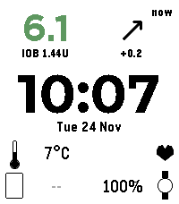
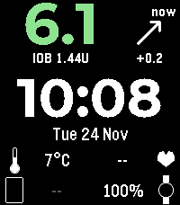
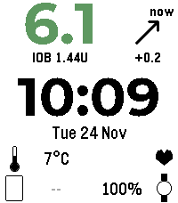
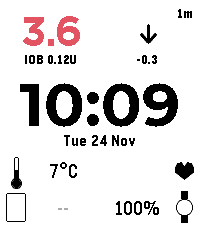
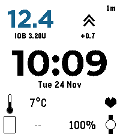
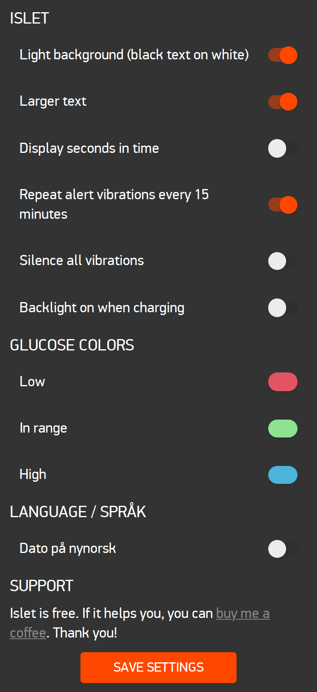

# Usage

## What face shows

| Where | What | From |
|---|---|---|
| Top left | Glucose, coloured low / in range / high | AndroidAPS |
| Under glucose | IOB, e.g. `IOB 1.44U` | AndroidAPS |
| Top right | Reading age, trend arrow, delta | AndroidAPS |
| Middle | Time, date (English or Nynorsk) | Watch |
| Lower left | Temperature | Open-Meteo, phone location |
| Lower right | Heart rate | Pebble Health |
| Bottom | Phone battery, watch battery | Pebble app / watch |

- Unit follow AndroidAPS (mmol/L or mg/dL).
- Colour switch at 4.0 / 10.0 mmol/L (70 / 180 mg/dL). Colours changeable in settings.
- IOB go grey (`IOB --`) when older than 15 min. Stale value never look fresh.
- Watch ask phone for new data every minute.

## How it work

```
CGM ──▶ AndroidAPS ──HTTP 127.0.0.1:28891──▶ Pebble app (PebbleKit JS) ──Bluetooth──▶ watch
```

AndroidAPS Garmin plugin run tiny web server. Only apps on same phone reach it. Islet phone script ask it `sgv.json?count=1`, send result to watch. All stay on phone.

Check server alive: open `http://127.0.0.1:28891/sgv.json?count=1` in browser **on phone**. See JSON = good.

## Settings

In Pebble app → Islet → settings.

| Setting | Default | Does |
|---|---|---|
| Light background (black text on white) | Off | Invert face. Bright glucose colours (like default green) darken by themselves so stay readable on white. |
| Larger text | Off | Much bigger glucose, bigger age / delta / IOB / date. Time already big, stay same. |
| Display seconds in time | Off | `HH:MM:SS`. Eat more battery. |
| Repeat alert vibrations every 15 minutes | On | Buzz again while watch disconnected from phone |
| Silence all vibrations | Off | No buzz ever |
| Backlight on when charging | Off | Light stay on while charging |
| Glucose colors | Red / green / blue | Low / in range / high colours |
| Dato på nynorsk | Off | Date in Nynorsk |

<p>
  
  
  
</p>

Light background · Larger text · Both.

<p>
  
  
  
</p>

Light background, low / in range / high. Default green and blue darken on white.



Location permission only for weather.

## Troubleshooting

| See | Why | Fix |
|---|---|---|
| `---` not glucose | Phone can't reach AndroidAPS | Check Local HTTP server on, AndroidAPS running. Open URL above on phone. |
| Grey `IOB --` | No IOB for 15 min | Same as above. Also let Pebble app run in background, battery optimisation off. |
| Reading age keep growing | AndroidAPS get no CGM data | Check CGM app and AndroidAPS |
| Phone battery `--` | Phone no report battery | Nothing to fix. Rest work. |

More detail: turn on Pebble app developer connection, run `pebble logs --phone <PHONE_IP>`. Every fetch logged.
